# Stage 4.0A - Expanded experiment inventory and evaluation

Generated 2026-11-19 10:53 UTC by `build_stage4_0a_report.py`. Read-only audit: no training, inference, prediction regeneration, protected-file edits, locked-test access, commit or push.

## Rules applied

- Every metric stays inside its own evaluation partition and target transformation. No cross-experiment ranking is made.
- Loss histories with `train_mse_scaled` / `validation_mse_scaled` come from the Mendeley tabular MLP (E1, E2, E3). Cambridge GraphSAGE losses (E8) are L1 on log1p(days). They are never plotted on shared axes.
- Synthetic results (E4) are a pipeline test, never evidence of real-world accuracy.
- Stage 2.3E held-out numbers are historical, on the same 99 locked blocks that Stage 3.7 protects. They are reproduced from the stored aggregate only.

## Chronological overview

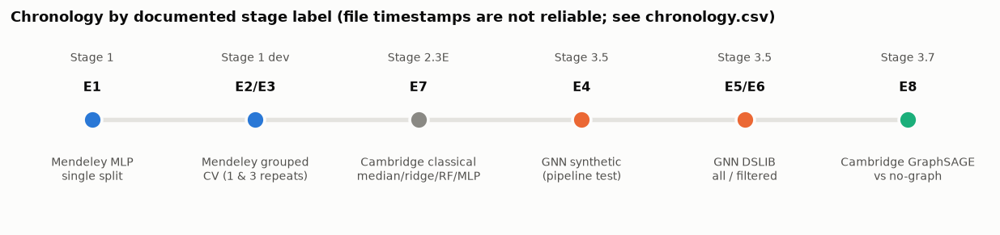

| order | id | stage | evidence_first_commit | file_mtime_note |
|---|---|---|---|---|
| 1 | E1 | Stage 1 | fbf0413 2026-11-11 | all artefacts 2026-11-12 10:12:50 (copy time, not training time) |
| 2 | E2 | Stage 1 dev validation | fbf0413 2026-11-11 | 2026-11-12 10:12 (copy time) |
| 3 | E3 | Stage 1 dev validation | fbf0413 2026-11-11 | 2026-11-12 10:12 (copy time) |
| 4 | E7 | Stage 2.3E | 30f5330 2026-11-16 | run_log.txt: 2026-11-12T18:38:43 to 18:59:12 +01:00 |
| 5 | E4 | Stage 3.5 | 30f5330 2026-11-16 | model.pt mtime 2026-11-12 15:31 (earlier than the E7 run log; conflict unresolved) |
| 6 | E5 | Stage 3.5 | 30f5330 2026-11-16 | model.pt mtime 2026-11-12 15:36 |
| 7 | E6 | Stage 3.5 | 30f5330 2026-11-16 | model.pt mtime 2026-11-12 15:37 |
| 8 | E8 | Stage 3.7 | 30f5330 2026-11-16 | run started 2026-11-16T18:26:10 +01:00 at commit cc38083 (dirty tree) |

Stage labels define the order. The Stage 3.5 GNN checkpoints have file times earlier than the Stage 2.3E run log, so file times are not used.

## Experiment inventory

| id | stage | name | target | loss | comparable_group |
|---|---|---|---|---|---|
| E1 | Stage 1 (duration v1) | Mendeley tabular MLP - single held-out split | ProjDura (total project duration, unit unverified), StandardScaler on fitting rows | MSE on standardized ProjDura (train_mse_scaled / validation_mse_scaled) | G1 Mendeley 10-row test |
| E2 | Stage 1 development validation (1 repeat) | Mendeley grouped 5-fold CV, 1 repeat | ProjDura, StandardScaler on each fold's fitting rows | MSE on standardized ProjDura (train_mse_scaled / validation_mse_scaled) | G2 Mendeley dev CV (duplicate of E3 r1) |
| E3 | Stage 1 development validation (3 repeats) | Mendeley grouped 5-fold CV, 3 repeats | ProjDura, StandardScaler on each fold's fitting rows | MSE on standardized ProjDura (train_mse_scaled / validation_mse_scaled) | G2 Mendeley dev CV |
| E4 | Stage 3.5 | Duration GNN - synthetic schedules | log(actual_days / planned_days); reported in days via planned x exp(pred) | Huber (delta 0.5) on log ratio - per-epoch values NOT saved | G3 synthetic only |
| E5 | Stage 3.5 | Duration GNN - DSLIB all G/G projects | log(actual_days / planned_days); reported in days | Huber (delta 0.5) on log ratio - per-epoch values NOT saved | G4 DSLIB all |
| E6 | Stage 3.5 | Duration GNN - DSLIB filtered (sensitivity) | log(actual_days / planned_days); reported in days | Huber (delta 0.5) on log ratio - per-epoch values NOT saved | G5 DSLIB filtered |
| E7 | Stage 2.3E | Cambridge classical models (median, ridge, random forest, MLP) | Raw reported elapsed calendar days (no log); MLP target standardized | MLP: MSE on standardized days (train), L1 on standardized days (stopping) - NOT saved | G6 Cambridge dev raw days |
| E8 | Stage 3.7 | Cambridge GraphSAGE vs matched no-graph network | log1p(days); predictions expm1 and clipped at 0; 3-seed mean of log predictions | L1 on log1p(days) (train_l1_log, inner_stop_l1_log, outer_val_l1_log_monitor_only) | G7 Cambridge dev log1p-trained |

## Loss-history provenance

| path | experiment | run | columns | rows |
|---|---|---|---|---|
| models/duration_v1/loss_history.csv | E1 | single | epoch|train_mse_scaled|validation_mse_scaled | 2000 |
| data/processed/duration_validation/repeat_1_fold_1/loss_history.csv | E2 | r1f1 | epoch|train_mse_scaled|validation_mse_scaled | 546 |
| data/processed/duration_validation/repeat_1_fold_2/loss_history.csv | E2 | r1f2 | epoch|train_mse_scaled|validation_mse_scaled | 625 |
| data/processed/duration_validation/repeat_1_fold_3/loss_history.csv | E2 | r1f3 | epoch|train_mse_scaled|validation_mse_scaled | 562 |
| data/processed/duration_validation/repeat_1_fold_4/loss_history.csv | E2 | r1f4 | epoch|train_mse_scaled|validation_mse_scaled | 1620 |
| data/processed/duration_validation/repeat_1_fold_5/loss_history.csv | E2 | r1f5 | epoch|train_mse_scaled|validation_mse_scaled | 528 |
| data/processed/duration_validation_repeated/repeat_1_fold_1/loss_history.csv | E3 | r1f1 | epoch|train_mse_scaled|validation_mse_scaled | 546 |
| data/processed/duration_validation_repeated/repeat_1_fold_2/loss_history.csv | E3 | r1f2 | epoch|train_mse_scaled|validation_mse_scaled | 625 |
| data/processed/duration_validation_repeated/repeat_1_fold_3/loss_history.csv | E3 | r1f3 | epoch|train_mse_scaled|validation_mse_scaled | 562 |
| data/processed/duration_validation_repeated/repeat_1_fold_4/loss_history.csv | E3 | r1f4 | epoch|train_mse_scaled|validation_mse_scaled | 1620 |
| data/processed/duration_validation_repeated/repeat_1_fold_5/loss_history.csv | E3 | r1f5 | epoch|train_mse_scaled|validation_mse_scaled | 528 |
| data/processed/duration_validation_repeated/repeat_2_fold_1/loss_history.csv | E3 | r2f1 | epoch|train_mse_scaled|validation_mse_scaled | 198 |
| data/processed/duration_validation_repeated/repeat_2_fold_2/loss_history.csv | E3 | r2f2 | epoch|train_mse_scaled|validation_mse_scaled | 229 |
| data/processed/duration_validation_repeated/repeat_2_fold_3/loss_history.csv | E3 | r2f3 | epoch|train_mse_scaled|validation_mse_scaled | 185 |
| data/processed/duration_validation_repeated/repeat_2_fold_4/loss_history.csv | E3 | r2f4 | epoch|train_mse_scaled|validation_mse_scaled | 239 |
| data/processed/duration_validation_repeated/repeat_2_fold_5/loss_history.csv | E3 | r2f5 | epoch|train_mse_scaled|validation_mse_scaled | 302 |
| data/processed/duration_validation_repeated/repeat_3_fold_1/loss_history.csv | E3 | r3f1 | epoch|train_mse_scaled|validation_mse_scaled | 645 |
| data/processed/duration_validation_repeated/repeat_3_fold_2/loss_history.csv | E3 | r3f2 | epoch|train_mse_scaled|validation_mse_scaled | 395 |
| data/processed/duration_validation_repeated/repeat_3_fold_3/loss_history.csv | E3 | r3f3 | epoch|train_mse_scaled|validation_mse_scaled | 514 |
| data/processed/duration_validation_repeated/repeat_3_fold_4/loss_history.csv | E3 | r3f4 | epoch|train_mse_scaled|validation_mse_scaled | 282 |
| data/processed/duration_validation_repeated/repeat_3_fold_5/loss_history.csv | E3 | r3f5 | epoch|train_mse_scaled|validation_mse_scaled | 401 |
| models/gnn_cambridge/loss_curves.csv | E8 | 30 runs (model x fold x seed) | epoch|train_l1_log|inner_stop_l1_log|outer_val_l1_log_monitor_only|model|fold|seed | 984 |

## E1 - Mendeley tabular MLP - single held-out split

*Stage 1 (duration v1) - `models/duration_v1`*

**Research objective.** Predict total project duration (ProjDura) from nine physical project descriptors with a small MLP, as the first PMI duration model.

**Dataset and features.** Mendeley tabular dataset. 40 training rows (32 fitting, 8 inner validation, grouped by project name) and a separate 10-row test file. Features: AreaSite, BuiltArea, TowerNum, TowerHgt, TowerFlr, BasementNum, AreaBase, UnitNum, AreaUnit. Cost columns excluded. Two different records named Pr29 remain grouped. Duration unit unverified.

**Model architecture.** See `figures/architecture/A1_mendeley_mlp.svg`.

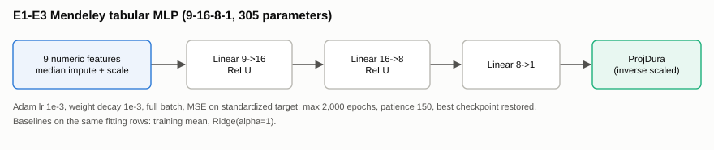

**Training and validation methodology.** One grouped fitting/validation split (seed 42). Imputer, feature scaler and target scaler fitted on the 32 fitting rows only. Best inner-validation epoch restored; no refit on all 40 rows. The 10 test rows were used once for final evaluation.

**Hyperparameters.**

| parameter | value |
|---|---|
| optimizer | Adam |
| learning rate | 0.001 |
| weight decay | 0.001 |
| batch | full batch (32 rows) |
| loss | MSE on standardized ProjDura |
| max epochs | 2000 |
| patience | 150 |
| seed | 42 |
| architecture | 9-16-8-1 ReLU |
| ridge alpha (baseline) | 1.0 |

**Maximum and executed epochs.** Maximum 2,000. Executed 2000. Restored epoch 1957.

**Best checkpoint and stopping criterion.** Lowest inner-validation scaled MSE (0.2332) at epoch 1957. Patience did not trigger; the run hit the epoch cap.

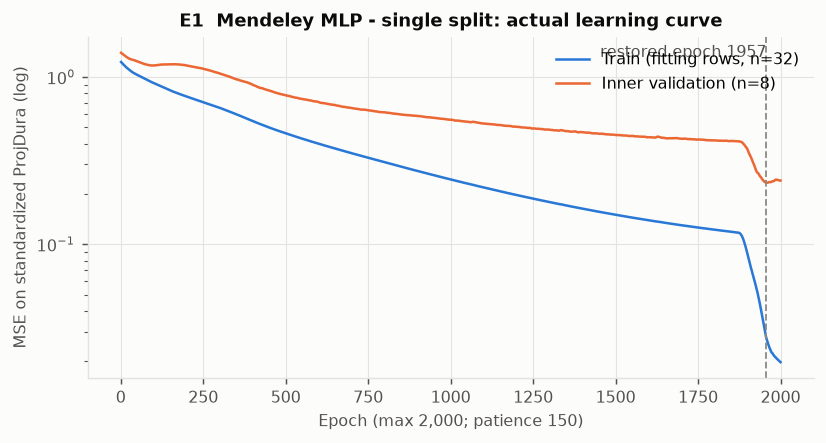

*E1 learning curve from models/duration_v1/loss_history.csv. The restored epoch is 1,957 of 2,000: patience never triggered.*

**Performance metrics.**

| model | MAE | RMSE | R2 |
|---|---|---|---|
| mlp | 2.686 | 3.609 | 0.8657 |
| mean | 8.239 | 9.849 | -2.265e-07 |
| ridge | 4.522 | 5.915 | 0.6393 |

10-row test file, ProjDura source units. Not comparable to any other experiment.

**Convergence, overfitting or underfitting.** Inner-validation loss fell from 1.395 to 0.233 and was still falling at the cap (drop over the last 200 epochs 0.1772). Training loss ended at 0.020, about a tenth of the validation loss, so the 305-parameter network fits its 32 rows far more closely than unseen rows. Validation loss never turned upward, so there is no classic overfitting turn within budget, but convergence was not reached: the stopping rule never fired.

**Research limitations.**

- Only 8 validation rows and 10 test rows; R2 of 0.866 on 10 rows is weak evidence.
- Later grouped CV (E3) gave mean MLP R2 of -0.28, so the single-split result did not generalise.
- Input hashes in metrics.json were recorded under another machine path; current files still match.
- Total-project duration; not an activity-level or IFC-change delay estimate.

**Reason for moving to the next experiment.** A single 10-row test cannot separate model quality from split luck. Grouped repeated CV on the development rows (E2/E3) was the next step.

## E2 - Mendeley grouped 5-fold CV, 1 repeat

*Stage 1 development validation (1 repeat) - `data/processed/duration_validation`*

**Research objective.** First grouped 5-fold development validation of the E1 recipe, without loading the 10-row test file.

**Dataset and features.** Same 40 Mendeley development rows and nine features as E1.

**Model architecture.** See `figures/architecture/A1_mendeley_mlp.svg`.

**Training and validation methodology.** GroupKFold(5, shuffle, seed 42) by project name. Each outer fold calls the E1 trainer, which makes its own grouped inner validation split.

**Hyperparameters.**

| parameter | value |
|---|---|
| as E1 | all MLP and ridge settings identical |
| repeats | 1 (seed 42) |

**Maximum and executed epochs.** Per fold, identical to E3 repeat 1 (see E3).

**Best checkpoint and stopping criterion.** As E3 repeat 1.

**Actual learning curves.** Identical to E3 repeat 1; see the E3 figure.

**Performance metrics.**

| fold | model | MAE | RMSE | R2 |
|---|---|---|---|---|
| 1 | mlp | 5.736 | 8.575 | 0.2883 |
| 1 | mean | 8.315 | 10.25 | -0.01693 |
| 1 | ridge | 6.166 | 7.152 | 0.5049 |
| 2 | mlp | 10.65 | 12.4 | -0.784 |
| 2 | mean | 9.536 | 11.64 | -0.5723 |
| 2 | ridge | 8.377 | 9.861 | -0.1291 |
| 3 | mlp | 5.85 | 7.876 | -0.2471 |
| 3 | mean | 5.766 | 7.157 | -0.02986 |
| 3 | ridge | 3.527 | 5.2 | 0.4563 |
| 4 | mlp | 6.486 | 10.09 | -0.3725 |
| 4 | mean | 5.25 | 8.866 | -0.05944 |
| 4 | ridge | 5.075 | 6.884 | 0.3613 |
| 5 | mlp | 5.562 | 7.859 | 0.1252 |
| 5 | mean | 8.59 | 10.62 | -0.5974 |
| 5 | ridge | 7.244 | 9.499 | -0.2779 |

Outer development folds. These five folds are byte-identical to E3 repeat 1 and must not be counted twice.

**Convergence, overfitting or underfitting.** Loss histories, checkpoints, fold CSVs and predictions are SHA-256 identical to E3 repeat 1 (verified file by file, not by size). Convergence is assessed under E3.

**Research limitations.**

- Duplicate evidence: E2 adds no independent information beyond E3 repeat 1.
- fold_manifest.json input hashes were recorded on another machine path.

**Reason for moving to the next experiment.** One repeat gives a single grouping of 40 rows. E3 added two further shuffles to show grouping variance.

## E3 - Mendeley grouped 5-fold CV, 3 repeats

*Stage 1 development validation (3 repeats) - `data/processed/duration_validation_repeated`*

**Research objective.** Measure how stable the Mendeley MLP, ridge and mean baselines are across three different project groupings.

**Dataset and features.** 40 Mendeley development rows, nine features; 10-row test file never loaded. 24-26 fitting, 7-8 inner validation and 7-9 evaluation rows per fold.

**Model architecture.** See `figures/architecture/A1_mendeley_mlp.svg`.

**Training and validation methodology.** 3 repeats x GroupKFold(5) with seeds 42, 43, 44. Inner grouped validation chooses the MLP epoch; outer rows never select anything. Preprocessing and baselines fitted on inner fitting rows only.

**Hyperparameters.**

| parameter | value |
|---|---|
| as E1 | Adam lr 1e-3, wd 1e-3, MSE scaled, max 2000, patience 150 |
| repeats | 3 |
| seeds | 42, 43, 44 |

**Maximum and executed epochs.** Maximum 2,000 per fold. Executed 185-1620. Restored epochs 35-1470 (median 251).

**Best checkpoint and stopping criterion.** Patience 150 triggered in all 15 runs (executed = restored + 150). Lowest inner-validation scaled MSE restored.

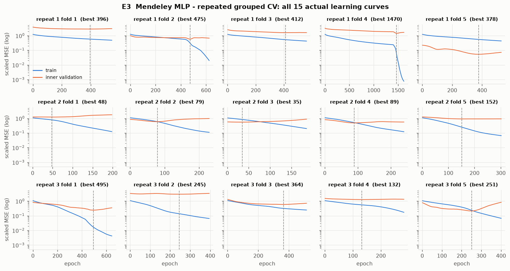

*E3: the 15 saved loss histories (train vs inner-validation, standardized ProjDura MSE). Dashed line = restored epoch. Repeat 1 is byte-identical to E2.*

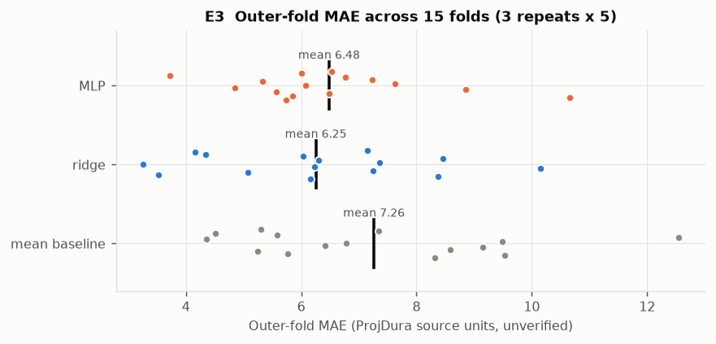

*E3 per-fold outer MAE from cross_validation.csv. Folds share training records, so spread is variation, not a confidence interval.*

**Performance metrics.**

| model | MAE_mean | MAE_std | RMSE_mean | RMSE_std | R2_mean | R2_std |
|---|---|---|---|---|---|---|
| mean | 7.263 | 2.306 | 9.173 | 2.653 | -0.322 | 0.407 |
| mlp | 6.485 | 1.665 | 8.47 | 1.976 | -0.278 | 0.755 |
| ridge | 6.254 | 1.955 | 7.763 | 2.212 | -0.182 | 1.011 |

Mean and SD over 15 outer folds. Ridge has the lowest mean MAE; all three have negative mean R2.

**Convergence, overfitting or underfitting.** All 15 runs stopped by patience. In 15 of 15 runs the inner-validation loss rose after the restored epoch while training loss kept falling (median further train drop 0.168), the classic overfitting signature on 7-8 validation rows. Inner-validation MSE at the restored epoch ranges 0.05-2.97 (scaled units), so stopping is driven by very small, noisy validation sets.

**Research limitations.**

- 40 records; folds share training rows, so SDs are variation, not confidence intervals.
- MLP mean MAE 6.48 vs ridge 6.25 vs mean 7.26: no model explains variance (R2 < 0).
- Unit and source licence unverified; repeated Pr29 identity unresolved.

**Reason for moving to the next experiment.** Project-level tabular data was too small to support a neural model. Work moved to activity-level schedule data (Cambridge, DSLIB) with many more labelled rows.

## E4 - Duration GNN - synthetic schedules

*Stage 3.5 - `models/gnn_synthetic`*

**Research objective.** Check that the graph pipeline can learn a neighbour-dependent effect when one is planted. A pipeline test, not a result.

**Dataset and features.** 120 projects in 120 independent groups, 2,510 labelled activities. 22 planning-time node features (CPM start/float, critical flag, degree, depth, project size, 12 trade one-hot). Labels follow a known synthetic rule.

**Model architecture.** See `figures/architecture/A2_duration_gnn.svg`.

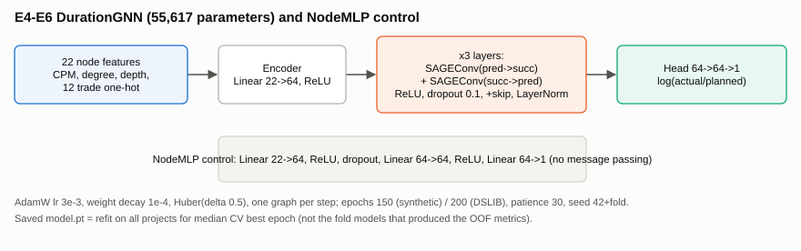

**Training and validation methodology.** 5-fold cross-validation over project groups; 15% of training groups held out for early stopping; scaling fitted on training nodes. Baselines: plan, global median ratio, per-category median ratio, NodeMLP. Paired bootstrap (2,000) over projects against the best non-graph method.

**Hyperparameters.**

| parameter | value |
|---|---|
| optimizer | AdamW |
| learning rate | 0.003 |
| weight decay | 1e-4 |
| loss | Huber delta 0.5 on log(actual/planned) |
| hidden | 64 |
| layers | 3 |
| dropout | 0.1 |
| max epochs | 150 |
| patience | 30 |
| seed | 42 + fold |
| folds | 5 |

**Maximum and executed epochs.** Maximum 150 per fold. Executed and per-fold best epochs were printed to the console only and not saved.

**Best checkpoint and stopping criterion.** Lowest early-stopping Huber loss, patience 30, best state restored. The saved model.pt is a separate refit on all projects for the median CV best epoch.

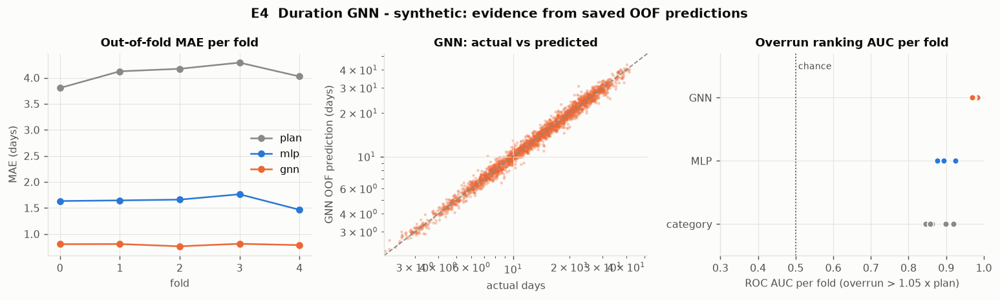

*E4 synthetic: labels come from a planted rule; these numbers test the pipeline only and are NOT evidence of real-world accuracy.*

**Performance metrics.**

| method | MAE_days | MedAE_days | MdAPE_pct | MAE_log_ratio | mean_project_MAE_days |
|---|---|---|---|---|---|
| plan | 4.083 | 3.138 | 24.31 | 0.2986 | 4.045 |
| median | 2.341 | 1.719 | 14.9 | 0.1635 | 2.397 |
| category | 1.81 | 1.188 | 9.4 | 0.1161 | 1.828 |
| mlp | 1.633 | 1.09 | 8.61 | 0.1064 | 1.653 |
| gnn | 0.795 | 0.531 | 4.44 | 0.0531 | 0.791 |

Activity OOF metrics in days on synthetic. GNN vs mlp: -0.863 days per project, 95% CI [-0.938, -0.796]. Overrun AUC per fold GNN 0.969-0.983, MLP 0.874-0.924. All stored values reproduced from oof_predictions.csv.

**Convergence, overfitting or underfitting.** No per-epoch history was saved, so convergence, overfitting and underfitting cannot be assessed from curves. Out-of-fold error is low and consistent across folds, which shows the model fits the planted rule without obvious overfitting.

**Research limitations.**

- Synthetic labels are generated by known rules. This is NOT evidence of real-world predictive accuracy.
- No learning curves or per-fold best epochs saved.

**Reason for moving to the next experiment.** The pipeline learned a planted graph effect, so it was applied to real DSLIB projects (E5).

## E5 - Duration GNN - DSLIB all G/G projects

*Stage 3.5 - `models/gnn_dslib`*

**Research objective.** Test whether precedence-network message passing predicts real activity deviation from plan on Ghent DSLIB building projects.

**Dataset and features.** 53 projects in 17 independent groups, 2,712 labelled activities. 22 planning-time node features (CPM start/float, critical flag, degree, depth, project size, 12 trade one-hot). 71% of labelled activities finished exactly on plan.

**Model architecture.** See `figures/architecture/A2_duration_gnn.svg`.

**Training and validation methodology.** 5-fold cross-validation over project groups; 15% of training groups held out for early stopping; scaling fitted on training nodes. Baselines: plan, global median ratio, per-category median ratio, NodeMLP. Paired bootstrap (2,000) over projects against the best non-graph method.

**Hyperparameters.**

| parameter | value |
|---|---|
| optimizer | AdamW |
| learning rate | 0.003 |
| weight decay | 1e-4 |
| loss | Huber delta 0.5 on log(actual/planned) |
| hidden | 64 |
| layers | 3 |
| dropout | 0.1 |
| max epochs | 200 |
| patience | 30 |
| seed | 42 + fold |
| folds | 5 |

**Maximum and executed epochs.** Maximum 200 per fold. Executed and per-fold best epochs were printed to the console only and not saved.

**Best checkpoint and stopping criterion.** Lowest early-stopping Huber loss, patience 30, best state restored. The saved model.pt is a separate refit on all projects for the median CV best epoch.

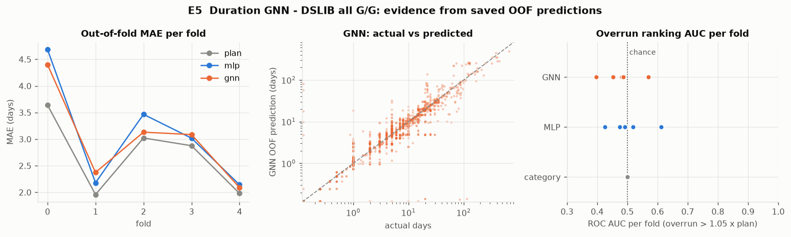

*E5 DSLIB all G/G: per-fold MAE, actual vs predicted and overrun AUC recomputed from saved OOF predictions.*

**Performance metrics.**

| method | MAE_days | MedAE_days | MdAPE_pct | MAE_log_ratio | mean_project_MAE_days |
|---|---|---|---|---|---|
| plan | 2.69 | 0 | 0 | 0.1589 | 4.78 |
| median | 2.69 | 0 | 0 | 0.1589 | 4.78 |
| category | 2.69 | 0 | 0 | 0.1589 | 4.78 |
| mlp | 3.092 | 0.297 | 6.81 | 0.2149 | 5.164 |
| gnn | 3.013 | 0.279 | 5.32 | 0.2026 | 5.247 |

Activity OOF metrics in days on DSLIB all G/G. GNN vs plan: +0.467 days per project, 95% CI [0.288, 0.636]. Overrun AUC per fold GNN 0.397-0.57, MLP 0.425-0.612. All stored values reproduced from oof_predictions.csv.

**Convergence, overfitting or underfitting.** No per-epoch history was saved, so convergence, overfitting and underfitting cannot be assessed from curves. Out-of-fold, both neural models are worse than 'actual = planned'. With most labels exactly on plan, this is consistent with fitting noise rather than signal.

**Research limitations.**

- Only 17 independent groups; labels dominated by on-plan values.
- 22% of activity names match no trade; FS/SS/FF/SF treated as FS in CPM features; lags ignored.
- No learning curves or per-fold best epochs saved; model.pt is not the fold model.

**Reason for moving to the next experiment.** No model beat the plan. A filtered sensitivity run (E6) checked whether tracking artefacts explained this.

## E6 - Duration GNN - DSLIB filtered (sensitivity)

*Stage 3.5 - `models/gnn_dslib_filtered`*

**Research objective.** Sensitivity variant of E5 after removing projects flagged by dslib.FILTER_RULES (for example tracking that mirrors the baseline).

**Dataset and features.** 40 projects in 15 independent groups, 2,051 labelled activities. 22 planning-time node features (CPM start/float, critical flag, degree, depth, project size, 12 trade one-hot). 64% of labelled activities finished exactly on plan.

**Model architecture.** See `figures/architecture/A2_duration_gnn.svg`.

**Training and validation methodology.** 5-fold cross-validation over project groups; 15% of training groups held out for early stopping; scaling fitted on training nodes. Baselines: plan, global median ratio, per-category median ratio, NodeMLP. Paired bootstrap (2,000) over projects against the best non-graph method.

**Hyperparameters.**

| parameter | value |
|---|---|
| optimizer | AdamW |
| learning rate | 0.003 |
| weight decay | 1e-4 |
| loss | Huber delta 0.5 on log(actual/planned) |
| hidden | 64 |
| layers | 3 |
| dropout | 0.1 |
| max epochs | 200 |
| patience | 30 |
| seed | 42 + fold |
| folds | 5 |

**Maximum and executed epochs.** Maximum 200 per fold. Executed and per-fold best epochs were printed to the console only and not saved.

**Best checkpoint and stopping criterion.** Lowest early-stopping Huber loss, patience 30, best state restored. The saved model.pt is a separate refit on all projects for the median CV best epoch.

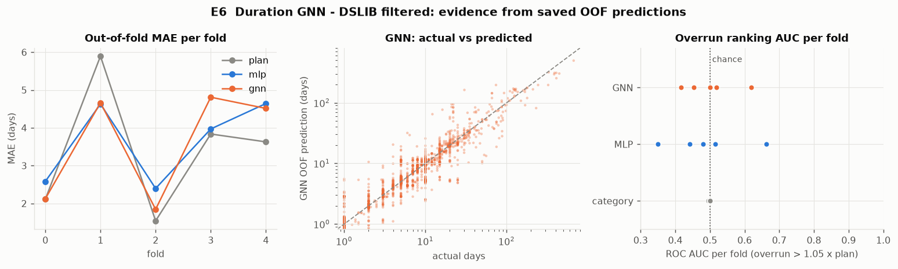

*E6 DSLIB filtered sensitivity variant: same views as E5.*

**Performance metrics.**

| method | MAE_days | MedAE_days | MdAPE_pct | MAE_log_ratio | mean_project_MAE_days |
|---|---|---|---|---|---|
| plan | 3.369 | 0 | 0 | 0.1685 | 6.004 |
| median | 3.369 | 0 | 0 | 0.1685 | 6.004 |
| category | 3.375 | 0 | 0 | 0.1689 | 6.01 |
| mlp | 3.624 | 0.557 | 11.11 | 0.2189 | 6.382 |
| gnn | 3.562 | 0.581 | 10.9 | 0.2186 | 6.8 |

Activity OOF metrics in days on DSLIB filtered. GNN vs plan: +0.796 days per project, 95% CI [-0.247, 1.897]. Overrun AUC per fold GNN 0.417-0.619, MLP 0.349-0.663. All stored values reproduced from oof_predictions.csv.

**Convergence, overfitting or underfitting.** No per-epoch history was saved, so convergence, overfitting and underfitting cannot be assessed from curves. Same pattern as E5; per-project MAE is worse for GNN than MLP (6.80 vs 6.38).

**Research limitations.**

- Only 15 groups; bootstrap CI crosses 0 but point estimate favours plan.
- Filtering rules chosen after inspecting E5 data; sensitivity only.
- No learning curves saved.

**Reason for moving to the next experiment.** Filtering did not change the conclusion. Too few independent groups; the larger Cambridge dataset with a frozen protocol became the main test bed (E8, building on E7).

## E7 - Cambridge classical models (median, ridge, random forest, MLP)

*Stage 2.3E - `data/processed/stage2/cambridge_experiment (+ models/cambridge_duration_v1)`*

**Research objective.** Exploratory retrospective estimates of reported completed-activity elapsed calendar days on Cambridge JPF data with non-graph models, under the frozen Stage 2.3D protocol.

**Dataset and features.** Cambridge JPF export. Features: activity_description, project_type, uk_region only. 144,110 development rows in 70 conservative blocks; 36,027 locked test rows in 99 blocks (not opened by this audit).

**Model architecture.** See `figures/architecture/A3_cambridge_classical.svg`.

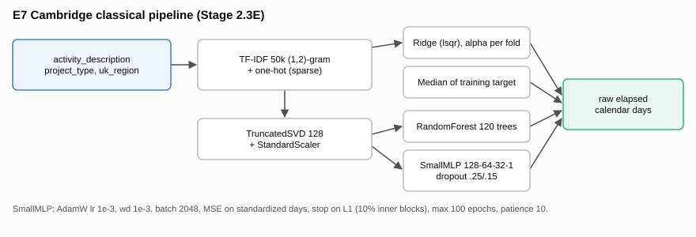

**Training and validation methodology.** Five frozen development folds (fold 0 = the dominant 99,636-row block). Ridge alpha selected per fold on a 10% inner block subset. Model order by mean development macro-group MAE, locked before the single held-out evaluation in Stage 2.3E.

**Hyperparameters.**

| parameter | value |
|---|---|
| ridge | lsqr, max_iter 2000, alpha by fold [10,10,10,10,1] |
| random forest | 120 trees, max_depth 24, min_samples_leaf 4, max_features 0.6 |
| MLP | 128-64-32-1, dropout .25/.15, AdamW lr 1e-3, wd 1e-3, batch 2048 |
| MLP loss | MSE on standardized days; stop on L1 |
| MLP max epochs / patience | 100 / 10 |
| text | TF-IDF 50k (1,2)-gram, min_df 2, max_df .98, sublinear |
| dense projection | TruncatedSVD 128 + StandardScaler |
| seed | 23051 |

**Maximum and executed epochs.** MLP maximum 100 per fold. Executed and best epochs were not saved.

**Best checkpoint and stopping criterion.** MLP: lowest L1 on standardized days over inner 10% development blocks, patience 10.

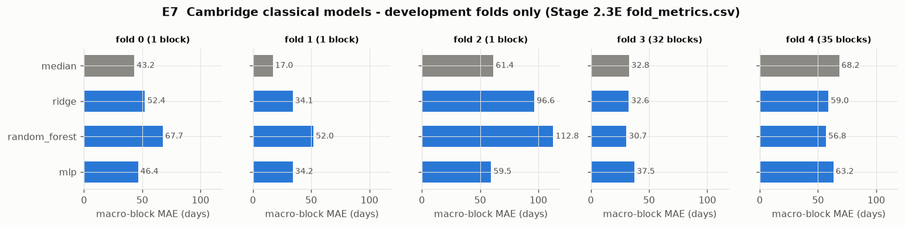

*E7 development-fold macro-block MAE. Held-out results on the 99 locked blocks are listed as a historical table only and are not plotted.*

**Performance metrics.**

| model | mean_of_fold_macro_group_mae_days | mean_of_fold_mae_days | mean_of_fold_rmse_days | mean_of_fold_r2 |
|---|---|---|---|---|
| median | 44.54 | 38.29 | 93.37 | -0.128 |
| mlp | 48.16 | 50.56 | 90.03 | -0.139 |
| ridge | 54.94 | 61.01 | 92.29 | -0.213 |
| random_forest | 63.96 | 77.53 | 109.4 | -0.886 |

Development folds only (mean over folds). The median wins on this statistic (44.54). The stored historical held-out table is shown separately below and is not used for any ranking.

**Historical held-out aggregate (Stage 2.3E, 99 locked blocks; not recomputed, not ranked against anything).**

| model | n | groups | mae_days | rmse_days | r2 | median_absolute_error_days | activity_weighted_mae_days | macro_group_mae_days |
|---|---|---|---|---|---|---|---|---|
| median | 36027 | 99 | 49.31 | 123.7 | -0.1455 | 8 | 49.31 | 33.3 |
| ridge | 36027 | 99 | 50.08 | 106.3 | 0.153 | 24.02 | 50.08 | 29.55 |
| random_forest | 36027 | 99 | 62.44 | 114.8 | 0.01334 | 42.63 | 62.44 | 25.8 |
| mlp | 36027 | 99 | 53.09 | 117.2 | -0.02947 | 24.2 | 53.09 | 33.19 |

**Convergence, overfitting or underfitting.** No learning curves were saved for the MLP, so convergence cannot be assessed. RF and ridge are non-iterative in this sense.

**Research limitations.**

- Target is reported elapsed calendar days, not verified working durations.
- Development folds are highly unequal; fold 0 is one block of 99,636 rows.
- The 99 locked blocks were already evaluated once in Stage 2.3E and must not be reused for confirmation.
- Prediction-time provenance of features is unverified.

**Reason for moving to the next experiment.** No non-graph model clearly beat the median. The next question was whether precedence-network context adds signal, under a matched-arm protocol on development folds only (E8).

## E8 - Cambridge GraphSAGE vs matched no-graph network

*Stage 3.7 - `models/gnn_cambridge`*

**Research objective.** Test, under a frozen pre-registered protocol, whether GraphSAGE message passing over the exported precedence network reduces error versus an identical network with no edges.

**Dataset and features.** Same 144,110 development rows / 70 blocks as E7, as 163 project graphs (all exported activities are nodes; only eligible development rows labelled). 139 node inputs. Locked test projects never materialised.

**Model architecture.** See `figures/architecture/A4_cambridge_sage.svg`.

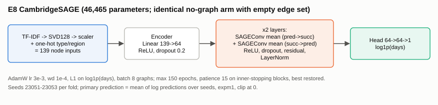

**Training and validation methodology.** 5 frozen development folds x 3 seeds per arm. Inner stopping blocks chosen by the Stage 2.3E hash rule. Outer fold loss logged for curves only. Primary metric mean block MAE over 70 blocks; paired 2,000-sample block bootstrap.

**Hyperparameters.**

| parameter | value |
|---|---|
| optimizer | AdamW |
| learning rate | 0.003 |
| weight decay | 1e-4 |
| loss | L1 on log1p(days) |
| batch | 8 graphs |
| hidden | 64 |
| graph layers | 2 |
| dropout | 0.2 |
| max epochs | 150 |
| patience / min_delta | 15 / 1e-4 |
| seeds | 23051, 23052, 23053 |
| protocol sha256 | ca2ae92ee8a65b82... |

**Maximum and executed epochs.** Maximum 150 per run. Executed 16-60; restored 1-45. GraphSAGE total 453 epochs, no-graph 531.

**Best checkpoint and stopping criterion.** Lowest inner-stopping L1, patience 15, best restored. All 30 runs stopped by patience. 7 runs restored epoch 1-4.

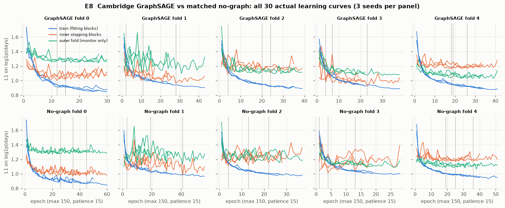

*E8 learning curves from models/gnn_cambridge/loss_curves.csv. Dashed lines = restored epoch per seed. Units are L1 on log1p(days) and are not comparable with E1-E3 scaled MSE.*

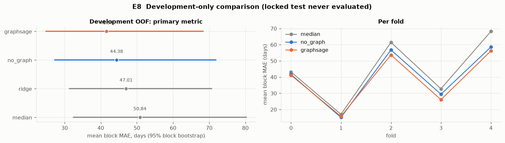

*E8 primary metric with stored block-bootstrap intervals, and per-fold mean block MAE.*

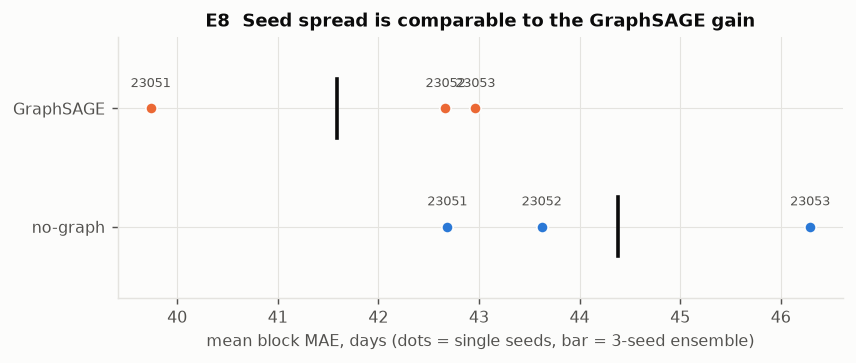

*E8 single-seed results versus the 3-seed ensemble (seed_metrics.csv).*

**Performance metrics.**

| model | n | blocks | mean_block_mae_days | activity_mae_days | rmse_days | r2 | median_absolute_error_days | mean_of_fold_macro_block_mae_days |
|---|---|---|---|---|---|---|---|---|
| median | 144110 | 70 | 50.84 | 39.9 | 106.6 | -0.123 | 7.333 | 44.54 |
| ridge | 144110 | 70 | 47.01 | 53.67 | 98.33 | 0.044 | 31.44 | 54.94 |
| no_graph | 144110 | 70 | 44.38 | 38.13 | 101.3 | -0.015 | 9.272 | 40.32 |
| graphsage | 144110 | 70 | 41.59 | 37.58 | 99.86 | 0.014 | 8.857 | 38.59 |

Development OOF only. GraphSAGE - no-graph mean block MAE -2.79 days, 95% CI [-4.21, -1.76]. Pre-registered criterion met. Stored values reproduced from oof_predictions.csv.

**Convergence, overfitting or underfitting.** Training L1 keeps falling while inner-stopping L1 plateaus within roughly 5-15 epochs; at the restored epoch the outer-fold L1 exceeds training L1 by a median 0.136. This indicates weak between-block signal and mild overfitting after early epochs, controlled by early stopping. The outer-fold monitor curve is nearly flat after the first epochs.

**Research limitations.**

- Development-only; the 99 locked blocks were not evaluated and must not be used to confirm this result.
- Gain is concentrated in small blocks; activity MAE improves only 0.55 days; R2 about 0; RMSE about 100 days.
- Seed spread is comparable to the effect; the bootstrap excludes seed uncertainty.
- training_runs.csv shows 7 runs restoring epoch 1-4; cambridge_training_results.md says four and lists five. The saved run table is authoritative.
- Executed protocol differs from the Stage 3.7B proposal (TF-IDF/SVD not hashing, 2 layers not 3, L1 on log1p not Huber, 150/15 not 200/30, 3 seeds not 5).
- Exported precedence may include execution-period edits; relation types merged, lags omitted, cycles retained.

**Reason for moving to the next experiment.** The development criterion was met with a small effect. The next stage needs a confirmatory design that does not reuse the already-used locked blocks, plus verified labels and planning-time edge provenance.

## Checkpoint metadata and hashes

Hashes, not file sizes, decide identity. The three Stage 3.5 `model.pt` files share a size of 232,503 bytes but have distinct SHA-256 values and distinct `source` metadata.

| experiment | path | bytes | sha256 |
|---|---|---|---|
| E4 | models/gnn_synthetic/model.pt | 232503 | d7a11033f3810ee4... |
| E5 | models/gnn_dslib/model.pt | 232503 | 6a4119198280e96e... |
| E6 | models/gnn_dslib_filtered/model.pt | 232503 | 43e564daf27fda90... |
| E1 | models/duration_v1/model.pt | 4221 | 67eecf4e02defeae... |
| E2 | data/processed/duration_validation/repeat_1_fold_1/model.pt | 4221 | ceeca78fffa7dcdf... |
| E2 | data/processed/duration_validation/repeat_1_fold_2/model.pt | 4221 | bfed0077b2158c0a... |
| E2 | data/processed/duration_validation/repeat_1_fold_3/model.pt | 4221 | 609a8dcad768bd85... |
| E2 | data/processed/duration_validation/repeat_1_fold_4/model.pt | 4221 | 7010cbd24a7f7242... |
| E2 | data/processed/duration_validation/repeat_1_fold_5/model.pt | 4221 | c1b5a91b9b4e1cb8... |
| E3 | data/processed/duration_validation_repeated/repeat_1_fold_1/model.pt | 4221 | ceeca78fffa7dcdf... |
| E3 | data/processed/duration_validation_repeated/repeat_1_fold_2/model.pt | 4221 | bfed0077b2158c0a... |
| E3 | data/processed/duration_validation_repeated/repeat_1_fold_3/model.pt | 4221 | 609a8dcad768bd85... |
| E3 | data/processed/duration_validation_repeated/repeat_1_fold_4/model.pt | 4221 | 7010cbd24a7f7242... |
| E3 | data/processed/duration_validation_repeated/repeat_1_fold_5/model.pt | 4221 | c1b5a91b9b4e1cb8... |
| E3 | data/processed/duration_validation_repeated/repeat_2_fold_1/model.pt | 4221 | 114d400dd48b339c... |
| E3 | data/processed/duration_validation_repeated/repeat_2_fold_2/model.pt | 4221 | 1809a0b7acee40fa... |
| E3 | data/processed/duration_validation_repeated/repeat_2_fold_3/model.pt | 4221 | 052d1113c5c11b4c... |
| E3 | data/processed/duration_validation_repeated/repeat_2_fold_4/model.pt | 4221 | fb92a8b4823f6ecc... |
| E3 | data/processed/duration_validation_repeated/repeat_2_fold_5/model.pt | 4221 | 32e827b113607aca... |
| E3 | data/processed/duration_validation_repeated/repeat_3_fold_1/model.pt | 4221 | aad4cfba8dc39ba4... |
| E3 | data/processed/duration_validation_repeated/repeat_3_fold_2/model.pt | 4221 | e0bf8125eff6171f... |
| E3 | data/processed/duration_validation_repeated/repeat_3_fold_3/model.pt | 4221 | 50f46b21d03d754a... |
| E3 | data/processed/duration_validation_repeated/repeat_3_fold_4/model.pt | 4221 | ed5af66a499fbd67... |
| E3 | data/processed/duration_validation_repeated/repeat_3_fold_5/model.pt | 4221 | 36925e6cf8adcb64... |
| E7 | models/cambridge_duration_v1/mlp_state.pt | 44589 | 20e5a59748b5785c... |
| E8 | models/gnn_cambridge/checkpoints/graphsage_fold0_seed23051.pt | 194521 | c296b7d31cf56e06... |
| E8 | models/gnn_cambridge/checkpoints/graphsage_fold0_seed23052.pt | 194521 | ed7e08bd1a14ad78... |
| E8 | models/gnn_cambridge/checkpoints/graphsage_fold0_seed23053.pt | 194521 | 8ef62c3859359dcd... |
| E8 | models/gnn_cambridge/checkpoints/graphsage_fold1_seed23051.pt | 196057 | aa0ae3323ffe944b... |
| E8 | models/gnn_cambridge/checkpoints/graphsage_fold1_seed23052.pt | 196057 | f0dc9695e9fd795b... |
| E8 | models/gnn_cambridge/checkpoints/graphsage_fold1_seed23053.pt | 196057 | e301a0c19c6dd33a... |
| E8 | models/gnn_cambridge/checkpoints/graphsage_fold2_seed23051.pt | 195801 | 8538864ad2387d69... |
| E8 | models/gnn_cambridge/checkpoints/graphsage_fold2_seed23052.pt | 195801 | 4e23edb4e2a821f8... |
| E8 | models/gnn_cambridge/checkpoints/graphsage_fold2_seed23053.pt | 195801 | 222f99e246c904a2... |
| E8 | models/gnn_cambridge/checkpoints/graphsage_fold3_seed23051.pt | 196057 | 6fde7c724ce90a58... |
| E8 | models/gnn_cambridge/checkpoints/graphsage_fold3_seed23052.pt | 196057 | 13e137f3aa70384d... |
| E8 | models/gnn_cambridge/checkpoints/graphsage_fold3_seed23053.pt | 196057 | ed76171be14517cc... |
| E8 | models/gnn_cambridge/checkpoints/graphsage_fold4_seed23051.pt | 196057 | 913718f18776eb96... |
| E8 | models/gnn_cambridge/checkpoints/graphsage_fold4_seed23052.pt | 196057 | 4ee69485c98e680a... |
| E8 | models/gnn_cambridge/checkpoints/graphsage_fold4_seed23053.pt | 196057 | 69831351c64c5ac0... |
| E8 | models/gnn_cambridge/checkpoints/no_graph_fold0_seed23051.pt | 194493 | 2e0ffdd7da0b768a... |
| E8 | models/gnn_cambridge/checkpoints/no_graph_fold0_seed23052.pt | 194493 | 5f9d167740da448e... |
| E8 | models/gnn_cambridge/checkpoints/no_graph_fold0_seed23053.pt | 194493 | 6368f4c58f1d3d94... |
| E8 | models/gnn_cambridge/checkpoints/no_graph_fold1_seed23051.pt | 196029 | 333bc35d52cac4cf... |
| E8 | models/gnn_cambridge/checkpoints/no_graph_fold1_seed23052.pt | 196029 | e2fb04cbe845145a... |
| E8 | models/gnn_cambridge/checkpoints/no_graph_fold1_seed23053.pt | 196029 | 1d391ccb46fb672b... |
| E8 | models/gnn_cambridge/checkpoints/no_graph_fold2_seed23051.pt | 195773 | 66fb37f160bf4038... |
| E8 | models/gnn_cambridge/checkpoints/no_graph_fold2_seed23052.pt | 195773 | cdc54200f1c6872c... |
| E8 | models/gnn_cambridge/checkpoints/no_graph_fold2_seed23053.pt | 195773 | af87cc99dc1de8ee... |
| E8 | models/gnn_cambridge/checkpoints/no_graph_fold3_seed23051.pt | 196029 | dd86892be9a91857... |
| E8 | models/gnn_cambridge/checkpoints/no_graph_fold3_seed23052.pt | 196029 | c79149d624c2894f... |
| E8 | models/gnn_cambridge/checkpoints/no_graph_fold3_seed23053.pt | 196029 | eb912ed1d37d0d4f... |
| E8 | models/gnn_cambridge/checkpoints/no_graph_fold4_seed23051.pt | 196029 | 507d4c64b1be291d... |
| E8 | models/gnn_cambridge/checkpoints/no_graph_fold4_seed23052.pt | 196029 | 138df4727fa49336... |
| E8 | models/gnn_cambridge/checkpoints/no_graph_fold4_seed23053.pt | 196029 | 02cee5ad6fe12e4e... |
| E7 | models/cambridge_duration_v1/classical_models.joblib | 101128764 | a224aec32bd4e641... |
| E7 | models/cambridge_duration_v1/preprocessing.joblib | 54976545 | 3b347a0de82bcbba... |
| E8 | models/gnn_cambridge/checkpoints/featurizer_fold0.joblib | 20403989 | 9c5b52c2c859587e... |
| E8 | models/gnn_cambridge/checkpoints/featurizer_fold1.joblib | 24315373 | 45a01d332be313c6... |
| E8 | models/gnn_cambridge/checkpoints/featurizer_fold2.joblib | 24313803 | d1f761d3e8abeca1... |
| E8 | models/gnn_cambridge/checkpoints/featurizer_fold3.joblib | 24322780 | edb6c050fe2bd566... |
| E8 | models/gnn_cambridge/checkpoints/featurizer_fold4.joblib | 24312236 | 5314ea0382a76bea... |

## Preservation verification

| check | total | passed |
|---|---|---|
| E1_metrics_input_sha256 (recorded on another machine path) | 2 | 2 |
| E3_fold_manifest_input_sha256 | 30 | 30 |
| E7_source_hash_vs_E8_provenance | 2 | 2 |
| E8_protocol_sha256 config vs metrics | 1 | 1 |
| before_vs_after_stage4_0a | 342 | 342 |
| git status of tracked protected paths | 1 | 1 |
| gnn_cambridge_preservation_manifest | 53 | 53 |

Failures: 0. Full list in `csv/preservation_verification.csv`.

## Unavailable evidence

| experiment | missing_evidence | reason |
|---|---|---|
| E4-E6 | Per-epoch training/validation loss histories | train.py keeps losses in memory only; nothing saved |
| E4-E6 | Per-fold best and executed epochs | printed to console only; not in metrics.json |
| E4-E6 | Fold-level checkpoints behind the OOF metrics | only a refit-on-all model.pt was saved |
| E4-E6 | Paired GNN vs MLP significance test | bootstrap compares GNN only with the best non-graph method |
| E4-E6 | Run log, environment beyond python/torch versions, git commit | not written by train.py |
| E7 | MLP loss history, executed and best epochs (CV and final) | fit_mlp does not record them |
| E7 | Development OOF predictions file | only fold-level metrics were saved |
| E7 | Hashes of models/cambridge_duration_v1 at creation time | no manifest written; current hashes recorded here |
| E7 | Row-level held-out evidence | deliberately not opened: locked-test derived |
| E1-E3 | Verified duration unit and source licence for Mendeley data | flagged as unverified by the original pipeline |
| E1-E3 | Original-machine input files at the recorded paths | metrics.json paths point to another user's machine |
| E8 | Locked-test performance | protocol forbids evaluating the 99 locked blocks in this stage |
| E8 | Exact ensemble reconstruction from saved per-seed day predictions | per-seed predictions were clipped before saving |
| All | Reliable training timestamps for E1-E6 | file times reflect copy/checkout; only E7 and E8 have run logs |

