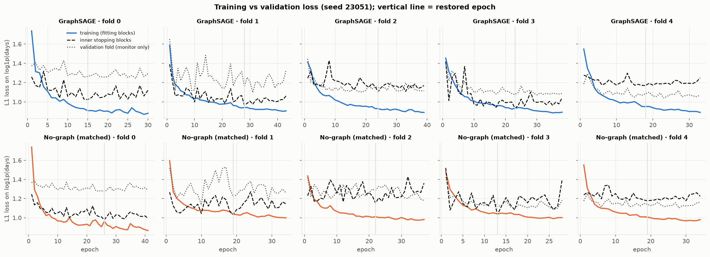

# Stage 3.7: Cambridge GNN training results

Run of the frozen protocol [`cambridge_training_protocol.md`](cambridge_training_protocol.md) (sha256 `ca2ae92e…93a1`), started 2026-11-16T18:26:10+01:00 at commit `cc38083` with a dirty working tree (the Stage 3.7 files themselves). Wall time 1,505 s on CPU. Outputs are in `models/gnn_cambridge/`.

**Scope.** Development blocks only. 144,110 labelled activities in 70 conservative blocks (163 project graphs). The 99 locked Stage 2.3E test blocks were not loaded. Stage 2.3E outputs were read, not written.

**Target.** Reported elapsed calendar days between exported actual start and finish timestamps. These are not verified actual construction durations, not working days, and not independently validated by anyone.

## What was trained

| Arm | Runs | Fitting rows per fold (folds 0–4) | Inner-stopping rows | Checkpoints |
|---|---:|---|---|---|
| GraphSAGE | 5 folds × 3 seeds = 15 | 43,382 / 124,017 / 134,200 / 134,932 / 129,216 | 1,092 / 1,092 / 1,092 / 850 / 6,567 | `checkpoints/graphsage_fold{f}_seed{s}.pt` |
| No-graph (matched) | 15 | same | same | `checkpoints/no_graph_fold{f}_seed{s}.pt` |
| Fold featurizers | 5 | TF-IDF → SVD-128 → scaler + one-hot, fit on fitting-project nodes | | `checkpoints/featurizer_fold{f}.joblib` |

Checkpoints total 118 MB and are git-ignored (`.gitignore`, as for the Stage 3.5 models). They can be regenerated by `train_cambridge.py` from the graph cache.

## Pipeline check: Stage 2.3E baselines reproduce exactly

The median and ridge baselines were re-run through this script with the Stage 2.3E definitions. Their per-fold activity MAE matches `data/processed/stage2/cambridge_experiment/fold_metrics.csv` to the printed precision in every fold (`metrics.json → stage23e_baseline_reproduction`, all absolute differences 0.0). The frozen folds, rows, targets and preprocessing are therefore the same as in Stage 2.3E.

## Training behaviour

Solid: training L1 on log1p(days) over the fitting blocks. Dashed: the inner-stopping blocks, which decided the restored epoch (vertical line). Dotted: the validation fold, logged for the chart only.

| Fold | GraphSAGE best epoch (3 seeds) | No-graph best epoch (3 seeds) | Best inner-stop L1, GraphSAGE / no-graph (mean) |
|---|---|---|---|
| 0 | 15, 15, 12 | 26, 45, 35 | 1.013 / 0.975 |
| 1 | 28, 11, 2 | 19, 3, 41 | 1.008 / 1.026 |
| 2 | 24, 4, 20 | 22, 4, 13 | 1.106 / 1.129 |
| 3 | 23, 4, 7 | 13, 4, 1 | 0.964 / 1.031 |
| 4 | 18, 19, 26 | 19, 36, 25 | 1.169 / 1.176 |

Observations:

1. **Training loss keeps falling while stopping loss plateaus within 5–15 epochs** in every fold. Both arms fit the fitting blocks better than any held-out block, which is the usual sign that the between-block signal is weak relative to within-block structure.
2. **The inner-stopping sets are small** (850–1,092 labelled rows in folds 0–3, from 3–6 blocks). Their curves are noisy, and four runs restored epoch 1–4 (no-graph fold 1 seed 23052, fold 3 seeds 23052 and 23053; GraphSAGE fold 1 seed 23053, fold 3 seed 23052). This was the frozen Stage 2.3E rule. Its noise is a limitation of the protocol, not something that was corrected after the fact.
3. **The validation-fold loss (dotted) moves little across epochs** after the first few, for both arms. Early stopping is therefore not the main driver of out-of-fold accuracy.
4. GraphSAGE used 453 epochs in total, the no-graph model 531.

## Out-of-fold predictions

`oof_predictions.csv` (144,110 rows) carries, for each development activity: block, fold, project type, reported days, the median and ridge predictions, each neural seed's prediction, and the three-seed mean (`pred_graphsage`, `pred_no_graph`). Per-fold, per-block and per-seed metrics are in `fold_metrics.csv`, `block_metrics.csv` and `seed_metrics.csv`. The numerical comparison is in [`cambridge_validation_results.md`](cambridge_validation_results.md).

## Provenance and environment

| Item | Value |
|---|---|
| Raw JSON | sha256 `e32f311e05c73b8b891b25149d85c95f27536d739f97d17bc52624fbc5ef8f47` (matches `design_freeze.json`) |
| Split manifest | sha256 `549e6e701413ee1f4c0e0799b0a4c601e948defbab6b71707a13328e437a3714` |
| Graph cache | `data/processed/gnn_cambridge/graph_manifest.json` (nodes/edges hashes recorded there) |
| Stage 2.3E `training_config.json` | read only, for the ridge alphas; hash in `provenance.json` |
| Python / torch / PyG / sklearn | 3.14.7 / 2.15.0+cpu / 2.8.1 / 1.9.1 |
| numpy / pandas / scipy / ijson / networkx | 2.5.4 / 3.1.0 / 1.18.1 / 3.6.0 / 3.7 |
| Hardware | Windows 11, Intel CPU, 16 torch threads |
| Seeds | 23051, 23052, 23053 (+1000 × fold) |

Full details: `models/gnn_cambridge/{environment.json, provenance.json, training_config.json, run_log.txt}`.
