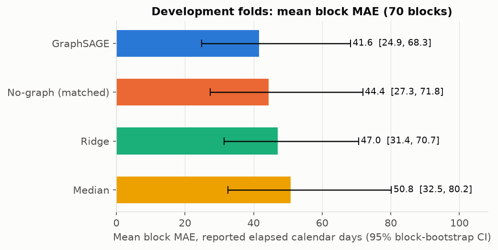
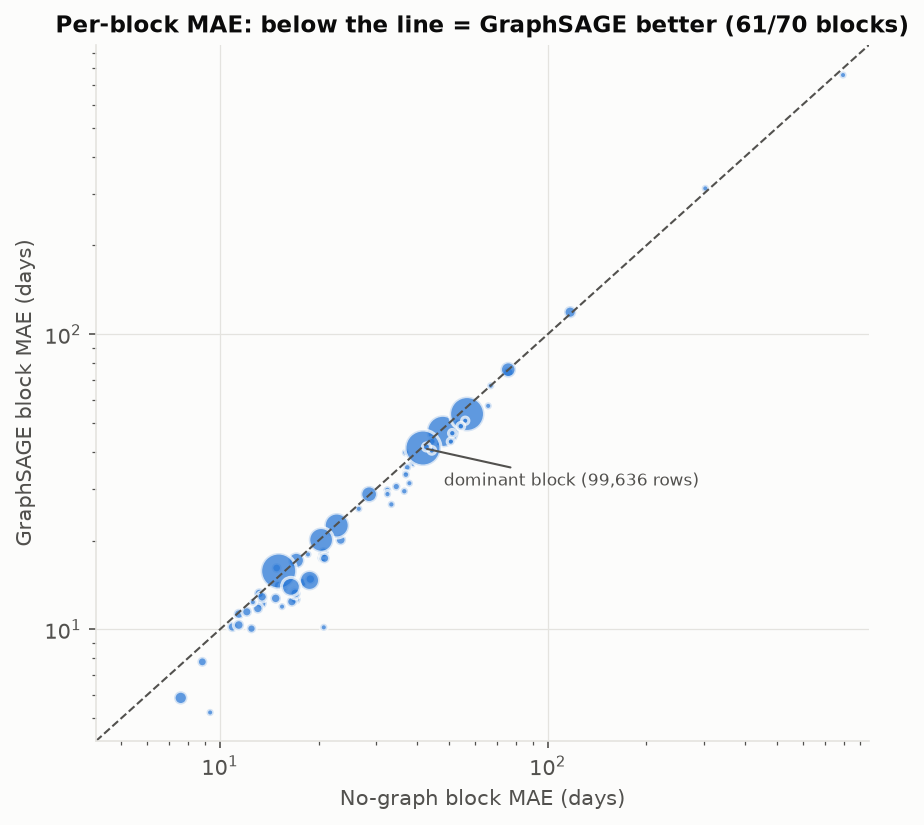
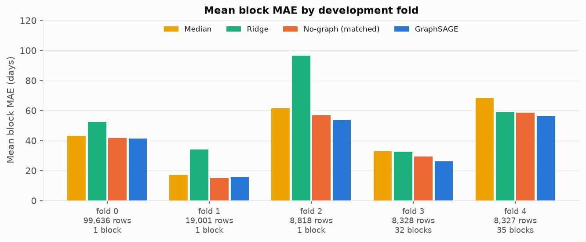
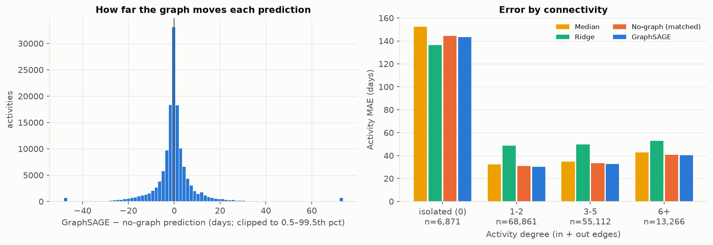
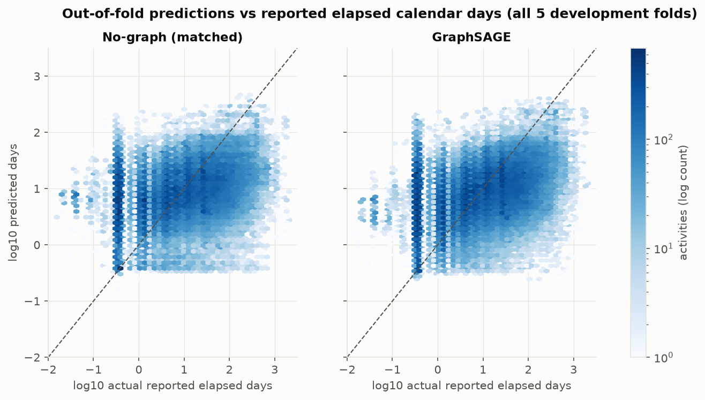

# Stage 3.7: Cambridge GNN validation results

**Headline.** On the five frozen development folds, GraphSAGE reaches a mean block MAE of **41.6 days**, versus 44.4 for the matched no-graph network, 47.0 for ridge and 50.8 for the median. The pre-registered success criterion is met: the paired block-bootstrap 95% CI of GraphSAGE − no-graph is [−4.2, −1.8] days, and GraphSAGE also beats both baselines. The gain is real under the protocol but **small, concentrated in small blocks, and comparable to the spread between seeds**. No model explains the variance of the target (R² ≈ 0; RMSE ≈ 100 days).

All figures are out-of-fold predictions on the development blocks. **The 99 locked test blocks were not evaluated.** The target is reported elapsed calendar days from exported actual timestamps, not verified construction durations.

## 1. Model comparison

| Model | Mean block MAE (primary) | 95% block-bootstrap CI | Activity MAE | RMSE | R² | Median AE | Stage 2.3E statistic* |
|---|---:|---|---:|---:|---:|---:|---:|
| Median | 50.84 | [32.5, 80.2] | 39.90 | 106.6 | −0.123 | 7.33 | 44.54 |
| Ridge | 47.01 | [31.4, 70.7] | 53.67 | 98.3 | 0.044 | 31.44 | 54.94 |
| No-graph (matched) | 44.38 | [27.3, 71.8] | 38.13 | 101.3 | −0.015 | 9.27 | 40.32 |
| **GraphSAGE** | **41.59** | [24.9, 68.3] | **37.58** | 99.9 | 0.014 | 8.86 | **38.59** |

\* Mean over folds of the per-fold macro block MAE: the Stage 2.3E selection statistic, where the median scored 44.54 and the MLP 48.16.



The wide single-model CIs reflect the between-block spread of the target itself (block medians range from 2 to 877 days). The paired differences below are much tighter because the same blocks enter both arms.

### Paired differences (mean block MAE, 2,000 block bootstraps, 70 blocks)

| Comparison | Difference | 95% CI | Blocks where GraphSAGE is better |
|---|---:|---|---:|
| GraphSAGE − no-graph | −2.79 | [−4.21, −1.76] | 61 / 70 (87%) |
| GraphSAGE − ridge | −5.42 | [−8.72, −1.81] | 51 / 70 (73%) |
| GraphSAGE − median | −9.25 | [−12.91, −6.82] | 65 / 70 (93%) |

**Success criterion:** (a) CI of GraphSAGE − no-graph entirely below 0: yes. (b) GraphSAGE below median and ridge: yes. → **met**.

## 2. Where the gain is



| Block size (labelled rows) | Blocks | Mean gain over no-graph (days) | Median gain | GraphSAGE better |
|---|---:|---:|---:|---:|
| < 100 | 56 | 3.27 | 2.72 | 52 / 56 |
| 100–1,000 | 8 | 1.00 | 0.80 | 4 / 8 |
| ≥ 1,000 | 6 | 0.72 | 0.36 | 5 / 6 |

The primary metric weights every block equally, so the 56 small blocks (mostly Clean Water Networks, folds 3–4) carry the result. In the six blocks that hold 92% of the activities, the gain is under one day. Activity-weighted MAE improves by 0.55 days (38.13 → 37.58).

### By fold



| Fold | Rows / blocks | Median | Ridge | No-graph | GraphSAGE |
|---|---|---:|---:|---:|---:|
| 0 (dominant block) | 99,636 / 1 | 43.19 | 52.38 | 41.66 | **41.19** |
| 1 | 19,001 / 1 | 17.03 | 34.12 | **15.12** | 15.78 |
| 2 | 8,818 / 1 | 61.45 | 96.60 | 56.79 | **53.70** |
| 3 | 8,328 / 32 | 32.80 | 32.63 | 29.44 | **26.08** |
| 4 | 8,327 / 35 | 68.21 | 58.96 | 58.60 | **56.18** |

GraphSAGE is behind the no-graph model in fold 1. Ridge is worse than the median in four of five folds, as in Stage 2.3E.

### By project type (activity MAE, days)

| Project type | Rows | Blocks | Median | No-graph | GraphSAGE |
|---|---:|---:|---:|---:|---:|
| Light Rail - Overground | 50,467 | 3 | 33.9 | 32.1 | 32.1 |
| Waste Water Treatment | 25,314 | 3 | 29.3 | 28.8 | 29.4 |
| Rail | 24,260 | 11 | 54.4 | 51.7 | 50.3 |
| Light Rail - Underground (inc. Tunnelling) | 11,564 | 2 | 71.3 | 69.4 | 69.1 |
| Marine Projects | 8,953 | 2 | 62.4 | 57.7 | 54.7 |
| Highways | 6,191 | 3 | 24.6 | 24.6 | 23.4 |
| Clean Water Networks | 5,991 | 51 | 24.8 | 19.2 | 18.2 |
| Light Rail - Underground (exc. Tunnelling) | 4,629 | 1 | 27.6 | 29.8 | 26.7 |
| Airports | 3,263 | 2 | 21.7 | 22.7 | 22.1 |
| Power Generation - Coal | 1,827 | 1 | 6.9 | 6.0 | 4.9 |
| Electrical Networks | 1,392 | 1 | 57.6 | 56.5 | 56.7 |
| Power Generation - Renewables | 259 | 1 | 14.4 | 14.6 | 14.4 |

Per-block metrics for all 70 blocks are in `models/gnn_cambridge/block_metrics.csv`. The worst blocks (MAE > 300 days) are a 1-row block with an 877-day activity and a 5-row block with a 242-day median; they enter the primary metric with the same weight as the dominant block.

## 3. GraphSAGE versus the no-graph model



| Statistic | Value |
|---|---|
| Spearman correlation of the two predictions | 0.864 |
| Mean / median / mean absolute difference (GraphSAGE − no-graph) | +0.24 / −0.18 / 6.25 days |
| 5th–95th percentile of the difference | −14.7 to +15.0 days |
| Activities where GraphSAGE is closer | 52.4% |

| Connectivity (in + out edges) | Rows | Median | Ridge | No-graph | GraphSAGE |
|---|---:|---:|---:|---:|---:|
| Isolated (0) | 6,871 | 152.4 | 136.4 | 144.3 | 143.4 |
| 1–2 | 68,861 | 32.2 | 48.7 | 30.8 | 30.3 |
| 3–5 | 55,112 | 34.9 | 49.8 | 33.4 | 32.8 |
| 6+ | 13,266 | 42.6 | 52.8 | 40.8 | 40.3 |

The graph changes individual predictions by several days either way, but the net activity-level gain is 0.4–0.6 days in every connectivity stratum. Isolated activities (no exported logic) are 4.8% of rows and carry a mean error of ~140 days for every model: they are dominated by long-running activities (long-duration administrative or summary-type items) that no feature in the allowlist distinguishes.

### Seed stability

| Seed | No-graph mean block MAE | GraphSAGE mean block MAE |
|---|---:|---:|
| 23051 | 42.69 | 39.74 |
| 23052 | 43.62 | 42.67 |
| 23053 | 46.29 | 42.96 |
| **3-seed mean prediction** | **44.38** | **41.59** |

GraphSAGE is better than the no-graph model for every seed, but the ranges overlap (no-graph seed 23051 at 42.7 is between GraphSAGE seeds 23052 and 23053). A single-seed comparison could have gone either way. The pre-registered test uses the three-seed mean prediction and bootstraps blocks, not seeds; it does not account for seed variance, and three seeds are too few to estimate it.



Both networks compress predictions into roughly 1–100 days while the target spans 0.02–2,000 days. The vertical band near log10(actual) ≈ −0.5 is the 8-hour (0.33-day) activities that the models cannot separate from multi-week ones from text alone.

## 4. Interpretation

1. **Exported precedence logic carries a small amount of transferable information** about reported elapsed duration, beyond the activity text and project context: −2.8 days of mean block MAE (6%), −0.55 days of activity MAE (1.4%).
2. **It does not make the predictions useful.** R² is ≈ 0 for every model; the RMSE (≈ 100 days) is twice the mean target; the median absolute error (8.9 days) is close to the median target (8.4 days). The Stage 2.3E conclusion stands: text, type and region, with or without schedule logic, do not predict reported elapsed duration for new projects.
3. **The feasibility caveat applies in full.** The edges are as-exported topology that may contain execution-period edits (feasibility report §3). A gain concentrated in small blocks is compatible with both a genuine planning-time signal and with topology that was tidied after the fact. This experiment cannot separate the two, because no earlier snapshot of any schedule exists.
4. **Compared with Stage 3.5 (Ghent).** There the GNN did not beat the plan or the MLP on 2,712 activities. Here, on 53× more activities and with no planned duration as input, a matched comparison shows a small but consistent advantage. The two findings are not in conflict: neither dataset supports a duration-correction model for PMI schedules.

## 5. Limitations

- Development-only. The result is a model-selection statistic. A confirmatory estimate would need the locked test blocks, which have been evaluated exactly once (Stage 2.3E) and must not be reused for this purpose.
- Reported elapsed calendar days, with unresolved calendars, time zones and 24-hour spans, not actual working durations.
- Feature provenance is as-exported and unverified for both nodes and edges.
- Mean block MAE with equal block weights is sensitive to the 56 small blocks and to 1–5-row blocks with extreme targets.
- Small inner-stopping sets made early stopping noisy; four of 30 runs restored epoch ≤ 4.
- Three seeds; seed variance is of the same order as the effect.
- Relationship types were merged into one directed relation; lags were not used; 34 projects contain cycles that were kept as-is.
- Four project types in development have no test-side counterpart, and the dominant block is never an unseen block (Stage 2.3D).

## 6. Reproducibility

```powershell
.venv\Scripts\python.exe research\gnn\cambridge_graph.py
.venv\Scripts\python.exe -m unittest tests.test_gnn_cambridge
.venv\Scripts\python.exe research\gnn\train_cambridge.py       # refuses to overwrite models/gnn_cambridge
.venv\Scripts\python.exe research\gnn\cambridge_figures.py
```

Tables in this document come from `models/gnn_cambridge/{model_comparison.csv, fold_metrics.csv, block_metrics.csv, seed_metrics.csv, metrics.json}`.
